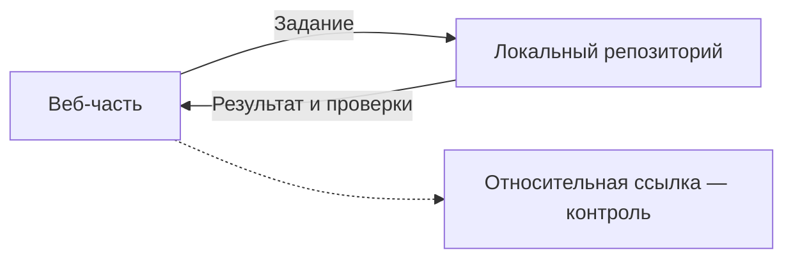

# 🧠 Command Center

Система работы специалиста с ChatGPT и Codex: от проработки решения до исполнения и проверки изменений.

## Проверка навигации по схеме

Нажмите на блоки **«Веб-часть»** и **«Локальный репозиторий»**: каждый должен открыть соответствующий документ. Второй переход ведёт сразу к разделу.

Это временная проверка кликабельной навигации перед подготовкой полного показа процесса.
