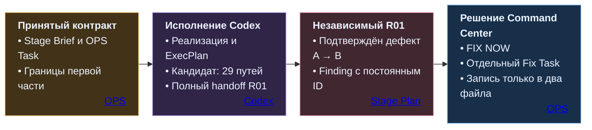
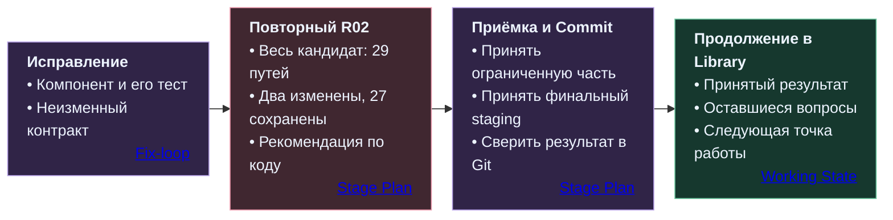

# Кейс: подтверждение просмотренной версии

[README](../../README.md) · [Устройство системы](SYSTEM.md) · [Этапы работы](STAGES.md) · [Проверка и завершение](REVIEW.md) · [Полный процесс](../../PRESENTATION.md)

В сервисе поиска вакансий пользователь проверяет подготовленный пакет профессиональных сведений и параметров поиска, затем принимает или отклоняет его. Фоновое обновление может заменить пакет на экране. **Решение человека должно относиться именно к той версии, которую он просмотрел.**

На этой задаче виден рабочий цикл Command Center: принятый контракт, реализация, независимый Review, точное задание на исправление, повторная проверка и приёмка конкретного результата. Область работы — **Stage 6 / Step 6.1, первая ограниченная часть локального веб-интерфейса**.

[Инженерная задача](#инженерная-задача) · [Путь работы](#как-прошла-работа) · [Исправление](#как-устранён-дефект) · [Проверки](#что-проверил-r02) · [Результат](#идентичность-принятого-результата)

## Инженерная задача

Пакет содержит сведения о профессиональном профиле, основания выводов и ещё не выясненные сведения, направления поиска и план работы с источниками. У него есть точная идентичность:

- `bundle_id` — идентификатор пакета;
- `sha256` — контрольная сумма его содержимого;
- `expected_parents` — ожидаемые версии исходных данных.

Операторский экран показывает пакет целиком и позволяет явно выбрать **ACCEPT** или **REJECT**. При записи сервер атомарно сопоставляет ожидаемые версии с текущими — **compare-and-swap, CAS** — и отклоняет устаревший запрос.

### Что обнаружил первый Review

| Момент | Действие и состояние |
|---|---|
| **На экране пакет A** | Пользователь изучает его содержимое |
| **Начинается медленное обновление** | Запрос `inspect` ещё выполняется; интерфейс позволяет подтвердить ознакомление и открыть подтверждение действия для A |
| **Приходит пакет B** | Экран обновляется, а прежнее согласие и открытое подтверждение сохраняются |
| **Пользователь завершает действие** | Запрос формируется уже из текущего B, хотя согласие было дано на A |

Ошибка воспроизводилась для обоих решений — ACCEPT и REJECT. Независимый Review R01 зафиксировал её как P1 с постоянным идентификатором **`S6-WEB-R01-01`**.

Серверная проверка сама по себе здесь недостаточна: запрос уже содержит корректные идентификаторы B, и CAS проверяет именно B. Связь между просмотренным материалом и намерением человека должна сохранять клиентская модель состояния.

## Как прошла работа



**Контракт перед реализацией.** Command Center и специалист определили первую часть веб-интерфейса и закрепили её в Stage Brief. OPS Task задавал поручение Codex с точными входами, границами, проверками и условиями остановки. Backend сохранял полномочия на проверку и запись; браузер передавал явное решение человека.

**Исполнение и возврат.** Codex работал в репозитории по принятому заданию, вёл ExecPlan и вернул изменения с результатами проверок. Полный кандидат R01 включал 29 путей. Специалист передал handoff в управляющий контур; независимый code review проверил реализацию и обнаружил подмену версии, к которой относилось согласие.

**Решение по finding.** Command Center выбрал `FIX NOW` и подготовил самостоятельный Fix Task. Он сохранял исходный архитектурный контракт и разрешал менять только:

```text
frontend/src/features/review/ReviewPage.tsx
frontend/src/features/review/ReviewPage.test.tsx
```

В задаче были явно заданы воспроизведение A → B, проверки ACCEPT/REJECT, медленного и ошибочного обновления, конкурентных ответов и повторной отправки. Backend, API, хранилище, зависимости и соседние вопросы оставались за границей исправления. Если решения в двух файлах было бы недостаточно, исполнитель должен был вернуть основания для расширения задачи до записи в другие пути.

## Как устранён дефект

Исправление связывает согласие и выбранное действие с **неизменяемым снимком идентичности просмотренного пакета**. Запрос решения формируется из этого снимка.

| Механизм | Какую границу сохраняет |
|---|---|
| **Снимок `bundle_id`, `sha256`, `expected_parents`** | Согласие относится к конкретному просмотренному материалу |
| **Сброс согласия и подтверждения сразу при запуске обновления** | Старое намерение перестаёт действовать до получения ответа |
| **Блокировка элементов управления на время обновления** | Во время неопределённого состояния нельзя подтвердить или отправить решение |
| **Проверка поколения ответа** | Поздний ответ старого запроса не подменяет более новое состояние |
| **Повторная сверка перед отправкой** | Просмотренная и текущая проверенная идентичности должны совпадать |
| **Сохранение точного повторного запроса** | При неизвестном исходе операции повторяется прежний запрос с прежним идентификатором операции |

После обновления B требует собственного ознакомления и явного решения. Открытое ранее подтверждение A не превращается в подтверждение B.

## Что проверил R02

Повторный Review получил **весь кандидат из 29 путей**, исходный Task/Brief, finding R01, Fix Task и новый handoff. Кроме корректности исправления проверялась его граница: относительно R01 изменились ровно два разрешённых файла, остальные 27 секций patch сохранились побайтово.

В отчёте R02 зафиксированы:

| Проверка | Результат |
|---|---|
| Frontend regression suite | **31 PASS** |
| Typecheck, lint и frontend build | **PASS** |
| Целевые Python-проверки Web и human review | **83 PASS** |
| Ruff и Pyright | **PASS** |
| Дополнительные сценарии на реальном React-компоненте | **22 PASS**, отдельно от основной suite |
| Дополнительные проверки security-рецензента | **4 PASS**, отдельно от основной suite |
| Отрицательный контроль на старом компоненте R01 | Исходный дефект воспроизведён **2/2**: ACCEPT и REJECT |

Отрицательный контроль проверяет чувствительность регрессии: старый компонент допускает ошибочную операцию, исправленный сохраняет связь с просмотренной версией. Дополнительные сценарии охватывали замену A → B, обновление A → A, ошибку запроса, заранее открытое подтверждение, поздние ответы, повторные клики и восстановление после неизвестного исхода операции.

Независимые рецензенты проверяли корректность и движение данных, безопасность, архитектуру и контракты. Основной проверяющий свёл их результаты и выдал рекомендацию принять первую часть. Решение о приёмке и финальном кандидате осталось за Command Center и специалистом.

## Идентичность принятого результата



После рекомендации R02 отдельно приняты ограниченная часть веб-интерфейса и точный финальный staged-кандидат. Сопоставление сохранённых patch с Git подтвердило:

| Сопоставление | Результат |
|---|---|
| R01 → R02 | **29 путей; 2 изменённые секции, 27 побайтово неизменных** |
| R02 → финальный staged patch | **Полное побайтовое совпадение** |
| Финальный patch → patch коммита `d777660` | **Полное побайтовое совпадение** |

В Library зафиксированы приёмка этой части, решения по оставшимся вопросам и дальнейшая точка работы. Область результата — ограниченная часть локального веб-интерфейса оператора с проверками на синтетических данных. Следующие части Stage 6 сохраняют собственные контракты и приёмку.

## Что показывает этот кейс

- **Контракт до реализации:** исполнителю известны цель, полномочия и обязательные свойства результата.
- **Независимый Review:** ошибка проверяется на конкретной последовательности действий, включая отрицательный контроль.
- **Ограниченный Fix:** два файла исправляются внутри большого кандидата, без повторной реализации остальных частей.
- **Проверяемая приёмка:** рассмотренный кандидат сопоставляется с окончательно зафиксированным результатом.
- **Продолжение работы:** принятое состояние и оставшиеся вопросы переходят в файловую память проекта.

## Связанные механизмы системы

| Механизм в кейсе | Где раскрыт |
|---|---|
| Stage, Step и решения по этапу | [Этапы и контрольные точки](STAGES.md) |
| Stage Brief, OPS Task и границы задания | [OPS: сборка задачи Codex](../../OPS_CENTER_CODEX_PROTOCOL.md#6-как-chatgpt-собирает-задачу-codex) |
| Вход в репозиторий, ExecPlan и субагенты | [Codex в репозитории](CODEX.md) |
| Handoff, findings и Fix-loop | [Проверка и завершение](REVIEW.md) |
| Приёмка кандидата и Commit | [Stage Plan: завершение Stage](../../Stage_Plan_Protocol.md#76-завершение-stage) |
| Принятый результат и точка продолжения | [Память проекта и Library](LIBRARY.md) |

[К началу](#кейс-подтверждение-просмотренной-версии) · [README](../../README.md) · [Проверка и завершение](REVIEW.md) · [Локальная инфраструктура](TOOLING.md) · [Полный процесс](../../PRESENTATION.md)
