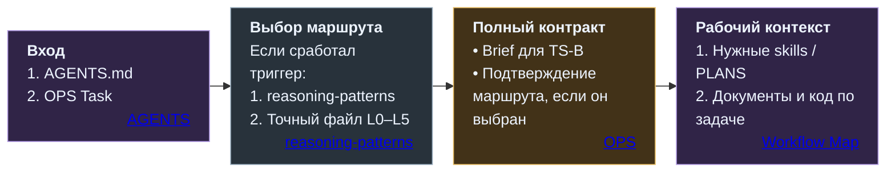
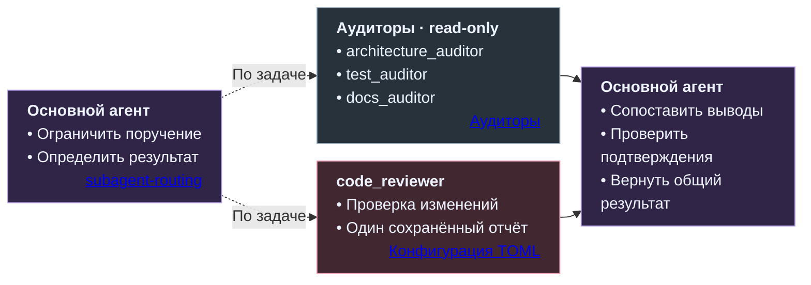

# Как Codex работает в репозитории

[README](../../README.md) · [Устройство системы](SYSTEM.md) · [Этапы работы](STAGES.md) · [Память проекта](LIBRARY.md) · [Локальная схема](../../PRESENTATION.md#repo-process)

Репозиторная часть Command Center определяет, как локальный Codex получает ограниченное поручение, загружает нужный контекст, выполняет работу и возвращает проверяемый результат. Codex предоставляет исполнение команд и работу с файлами; проектные правила, маршруты, skills и конфигурации субагентов организуют применение этих возможностей.

Основной агент отвечает за задачу целиком: проверяет контракт, выбирает достаточную тактику, подключает нужные процедуры и сводит результаты проверок. Архитектурные решения и приёмка результата остаются в контуре специалиста и управляющего чата.

[Вход в задачу](#последовательный-вход-в-задачу) · [Маршруты](#маршруты-l0l5) · [Skills](#семь-процедур-skills) · [Субагенты](#профильные-субагенты) · [ExecPlan](#execplan-память-локального-исполнения)

## Последовательный вход в задачу

Для поручения через OPS специалист передаёт короткий [Fixed Launch Prompt](../../OPS_CENTER_CODEX_PROTOCOL.md#64-fixed-launch-prompt) с точным путём Task. Этот запуск указывает, где читать задание; цель, границы, ожидаемый результат и проверки находятся в самом контракте.

Порядок загрузки задан [Workflow Map](../../AGENTS.md#agentic-workflow-map):

1. **AGENTS.md** — проектные ограничения, полномочия и входы в процедуры.
2. **OPS Task** — первоначальный файл задания, если он указан в запуске. В TS-A он содержит компактную спецификацию; в TS-B ссылается на подробный Stage Brief.
3. **Маршрут, когда вызван его выбор.** Skill reasoning-patterns разрешает метку в точный путь, после чего читается соответствующий файл тактики.
4. **Связанные артефакты задания.** Для TS-B читается Stage Brief. После получения полного контекста предварительный маршрут подтверждается, пересматривается через reasoning-patterns либо работа останавливается при конфликте.
5. **Применимые процедуры и материалы.** Подключаются нужные skills и правила ExecPlan, затем документы и код, относящиеся к задаче. Это позволяет сформулировать точные поручения субагентам, если они полезны и разрешены.

Stage Brief создаётся в веб-части раньше Task. Codex читает его после Task; если выбирался маршрут, сначала загружается его файл. Это разделение [порядка создания и порядка чтения](../../OPS_CENTER_CODEX_PROTOCOL.md#authoring-order-и-loading-order) сохраняет первоначальный контракт входа.

В опубликованном наборе **AGENTS.md — переносимый шаблон**. Проектные разделы адаптируются к конкретному репозиторию и принятой архитектуре. Общие §§3–4 сохраняют контракт загрузки и исполнения; изменение этого ядра требует отдельного архитектурного решения и Review.

## Маршруты L0–L5

**Маршрут — тактика организации работы внутри согласованной задачи.** Его выбор управляет объёмом планирования, сравнением вариантов, итерациями и проверками. Обозначения L0–L5 описывают процедуры исполнения, а не скрытые уровни мышления модели.

| Маршрут | Для какой работы | Как организует исполнение |
|---|---|---|
| [L0 Direct](../codex/reasoning/L0_direct.md) | Простая локальная задача с очевидным решением и небольшим риском | Минимальное изменение и достаточная проверка |
| [L1 Micro-plan](../codex/reasoning/L1_micro_plan.md) | Небольшая задача с несколькими ясными шагами | Короткий план в чате, исполнение и проверка |
| [L2 Plan Iterations](../codex/reasoning/L2_plan_iterations.md) | Работа из зависимых шагов, несколько файлов или важная подсистема | Разбиение на части и последовательные итерации; ExecPlan по масштабу работы |
| [L3 Independent Checks](../codex/reasoning/L3_self_consistency.md) | Аудит, Review, исследование рисков и сопоставление выводов | Отдельные проверки, сбор подтверждений и сведение результатов |
| [L4 Route Exploration](../codex/reasoning/L4_shallow_tree_of_thoughts.md) | Несколько правдоподобных архитектурных или стратегических направлений | Сравнение 2–5 вариантов по риску, стоимости, обратимости и проверяемости |
| [L5 Deep Branching](../codex/reasoning/L5_deep_tree_of_thoughts.md) | Разрешённые прототипы, параллельные варианты или глубокое исследование | Ограниченные ветви работы с проверками; явное разрешение и ExecPlan обязательны |

Выбор маршрута запускается при указании L0–L5, route hint, reasoning patterns, Plan Iterations, Self-consistency, Tree of Thoughts, ExecPlan или просьбе выбрать маршрут автоматически. Без такого триггера этот шаг загрузки пропускается. Точное соответствие меток и файлов определяет [reasoning-patterns](../../.agents/skills/reasoning-patterns/SKILL.md#route-file-resolution-rule).

Используется самый лёгкий достаточный маршрут. Рекомендация в Task может быть пересмотрена после изучения контекста с кратким объяснением существенного отклонения. Смена тактики сохраняет границы задания и полномочия. Форма TS-A/TS-B определяет упаковку спецификации и сама по себе не выбирает L0–L5.

## Семь процедур skills

Skills подключаются по характеру операции. Каждый файл задаёт процедуру в своих границах; необходимое разрешение на работу определяется поручением и проектными правилами.

| Skill | Ответственность |
|---|---|
| [reasoning-patterns](../../.agents/skills/reasoning-patterns/SKILL.md) | Выбор достаточного маршрута, разрешение его метки в точный путь и пересмотр при новых фактах |
| [audit-only](../../.agents/skills/audit-only/SKILL.md) | Исследование фактов и рисков без реализации; сохранение отчёта, если оно явно запрошено |
| [review-code](../../.agents/skills/review-code/SKILL.md) | Проверка изменений по фактам, контрактам, архитектуре и рискам; для большого review — последовательная работа с общим отчётом |
| [write-tests](../../.agents/skills/write-tests/SKILL.md) | Написание и обновление разрешённых тестов по ожидаемому поведению и публичным контрактам |
| [docs-update](../../.agents/skills/docs-update/SKILL.md) | Согласованное обновление документации в заданной области после принятого изменения |
| [report-writing](../../.agents/skills/report-writing/SKILL.md) | Сохранение результатов аудита, review, исследования или сравнения, когда нужен отдельный артефакт |
| [subagent-routing](../../.agents/skills/subagent-routing/SKILL.md) | Выбор существующих субагентов, подготовка ограниченных поручений и сведение результатов |

При прямых локальных поручениях действуют предусмотренные исключения из обычного порядка подключения процедур: например, задача только на [отчёт](../../.agents/skills/report-writing/SKILL.md#workflow-placement), только на [ExecPlan](../../.agents/PLANS.md#workflow-placement) или прямой [аудит с субагентами](../../.agents/skills/subagent-routing/SKILL.md#workflow-placement). Требование Task для управляемого OPS-пути не обязывает создавать его для каждого прямого запроса. Указанные входные артефакты, границы задачи и полномочия сохраняются.

## Профильные субагенты

В наборе предусмотрены четыре конфигурации TOML. Основной агент выбирает минимально полезный состав, передаёт каждому самостоятельное ограниченное поручение и проверяет полученные выводы. Субагенты подключаются, когда это улучшает покрытие проверки, снижает риск или разгружает основной контекст.

| Субагент | Что проверяет | Полномочия |
|---|---|---|
| [architecture_auditor](../../.codex/agents/architecture_auditor.toml) | Владельцев, слои, архитектурные границы, конфликты источников и риски расширения задачи | `read-only`: выводы и рекомендации |
| [test_auditor](../../.codex/agents/test_auditor.toml) | Пробелы и слабые тесты, фикстуры, безопасность проверок и внешних вызовов | `read-only`: преимущественно статический анализ; запуск проверок — по отдельному поручению |
| [docs_auditor](../../.codex/agents/docs_auditor.toml) | Соответствие документации коду, конфигурации и принятым источникам | `read-only`: замечания без исправления документов |
| [code_reviewer](../../.codex/agents/code_reviewer.toml) | Код и изменения по процедуре review-code | `workspace-write`; контракт субагента ограничивает запись одним Batched Code Review Report в `docs/codex/reports/` |

Основной агент сопоставляет подтверждения, противоречия и повторяющиеся замечания, сохраняя существенные findings. Результат проверки помогает принять решение; заключение субагента само по себе не разрешает реализацию, изменение архитектуры или Commit.

Для проверки с несколькими направлениями каждый code_reviewer получает свой предмет проверки и отдельный путь отчёта. Объединение выполняет основной агент. Правила поручений и консолидации принадлежат [subagent-routing](../../.agents/skills/subagent-routing/SKILL.md).

## ExecPlan: память локального исполнения

**ExecPlan сопровождает существенную реализацию:** длительную работу, крупный рефакторинг, архитектурно чувствительное изменение, разрешённые прототипы или возобновляемую задачу. Он содержит достаточный контекст, этапы исполнения, проверяемые результаты, прогресс, открытия и принятые по ходу работы решения.

В процессе обновляются четыре раздела: **Progress**, **Surprises & Discoveries**, **Decision Log**, **Outcomes & Retrospective**. Это позволяет другому исполнителю продолжить задачу по репозиторию и плану.

Правила находятся в [.agents/PLANS.md](../../.agents/PLANS.md); конкретный план, когда он сохраняется в репозитории, размещается в `docs/codex/plans/`. Небольшая локальная правка или аудит без реализации обычно обходятся без ExecPlan. Для L5 его наличие обязательно.

Для TS-B Stage Brief задаёт принятый контракт задачи, ExecPlan организует исполнение внутри него. В TS-A спецификация находится в самом Task. [Library](LIBRARY.md) сохраняет опорное состояние управляющего веб-чата, а ExecPlan — ход отдельной локальной работы. План и отчёт также различаются: отчёт фиксирует анализ, план сопровождает исполнение. Эти границы описаны в [PLANS](../../.agents/PLANS.md#stage-briefs-and-execplans).

## Проверки и возвращение результата

Codex выполняет проверки из задания и проектных правил, фиксирует результаты, причины пропусков и оставшиеся риски. После read-only работы возвращаются выводы с подтверждениями. После изменений для Review собирается [Repo change handoff](../../OPS_CENTER_CODEX_PROTOCOL.md#144-если-codex-изменил-repo):

- точные границы задачи и однозначно определённое состояние изменений;
- статус Git, отдельный diff и статистика;
- проверка diff, выполненная validation и причины пропусков;
- итог Codex, известные риски и препятствия;
- Task, Brief для TS-B и необходимые архитектурные основания для проверки.

Command Center определяет нужный режим handoff и готовит точные команды для получения материалов. Специалист передаёт пакет в управляющий чат, где результат проверяется относительно принятого контракта. Подробный процесс принятия решений и исправлений раскрыт в [этапах работы](STAGES.md#от-решения-к-работе-codex).

Обнаруженная рядом проблема не расширяет задачу автоматически. Существенное изменение требований, архитектуры, владельцев или риска возвращается на решение специалиста и Command Center. Исправление реализации внутри прежнего контракта может пройти Fix-loop. Git-операции — staging, Commit и push — выполняются по [явным инструкциям](../../Stage_Plan_Protocol.md#71-repo-change-handoff).

## Источники

Этот файл объясняет репозиторную часть. Точные процедуры и полномочия задают соответствующие элементы системы.

| Тема | Источник |
|---|---|
| Загрузка контекста и порядок исполнения | [AGENTS: Context Loading](../../AGENTS.md#3-context-loading-rules) · [Workflow Map](../../AGENTS.md#agentic-workflow-map) |
| Выбор маршрута и подтверждение после чтения контракта | [reasoning-patterns: Route handoff](../../.agents/skills/reasoning-patterns/SKILL.md#route-handoff) |
| Процедуры операций | [Skills](../../.agents/skills/) |
| Поручения субагентам и их границы | [subagent-routing](../../.agents/skills/subagent-routing/SKILL.md) · [Конфигурации TOML](../../.codex/agents/) |
| План длительной задачи | [ExecPlan](../../.agents/PLANS.md) |
| Постановка задания и проверяемая передача изменений | [OPS](../../OPS_CENTER_CODEX_PROTOCOL.md#6-как-chatgpt-собирает-задачу-codex) · [Repo change handoff](../../Stage_Plan_Protocol.md#71-repo-change-handoff) |

[К началу](#как-codex-работает-в-репозитории) · [README](../../README.md) · [Устройство системы](SYSTEM.md) · [Этапы работы](STAGES.md) · [Память проекта](LIBRARY.md) · [Локальная схема](../../PRESENTATION.md#repo-process)
