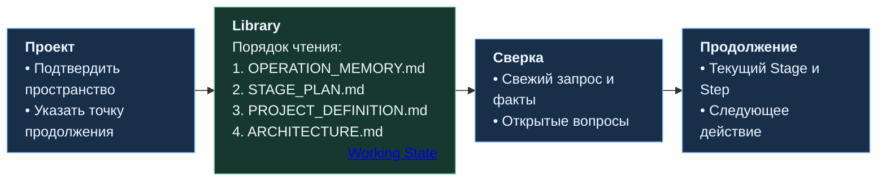

# Как Command Center сохраняет память проекта

[README](../../README.md) · [Устройство системы](SYSTEM.md) · [Этапы работы](STAGES.md) · [Полный процесс](../../PRESENTATION.md) · [Веб-схема](../../PRESENTATION.md#web-process)

Library хранит **опорное состояние проекта для управляющего веб-чата Command Center**: замысел, архитектурные решения, маршрут этапов и текущую точку продолжения. Эти сведения помогают удерживать направление длительной разработки и начинать следующий этап в новом чате.

История чата сохраняет обсуждение: вопросы, варианты, аргументы и принятые решения. В Library выделяется компактное актуальное состояние, на которое Command Center должен опираться дальше. Вместе они обеспечивают преемственность работы.

[Четыре файла](#четыре-владельца-состояния) · [Обновление файла](#как-обновляется-файл) · [Продолжение в новом чате](#продолжение-в-новом-чате)

## Четыре владельца состояния

У каждого проекта есть своё пространство `/Command Center/<project_name>/`. В нём четыре логических владельца; каждый отвечает за определённую часть состояния.

| Файл | Что хранит | Когда обновляется |
|---|---|---|
| [PROJECT_DEFINITION.md](../../Command_Center_Working_State_Protocol.md#53-project_definitionmd) | Назначение проекта, целевую аудиторию, требования, границы и ограничения | Когда принято изменение смысла проекта, требований или существенных границ |
| [ARCHITECTURE.md](../../Command_Center_Working_State_Protocol.md#54-architecturemd) | Действующую архитектуру и принятые архитектурные решения | После принятия решения или подтверждённого изменения представления об архитектуре |
| [STAGE_PLAN.md](../../Command_Center_Working_State_Protocol.md#52-stage_planmd) | Актуальный маршрут этапов, их состояния и краткие значимые итоги | При принятом изменении плана, смене или завершении этапа |
| [OPERATION_MEMORY.md](../../Command_Center_Working_State_Protocol.md#51-operation_memorymd) | Текущий вопрос, рабочие факты, гипотезы, замечания, препятствия и точку продолжения | Когда существенно меняется рабочий контекст или нужно сохранить непрерывность работы |

**Оперативная память допускает ещё не принятый рабочий материал.** Например, замечание после аудита сначала сохраняется вместе с его статусом. Если после обсуждения оно приводит к принятому изменению требований, архитектуры или плана, соответствующий смысл переносится к профильному владельцу. Избыточные оперативные записи затем убираются, когда перестают помогать текущей работе.

**Принятая архитектура и существующая реализация различаются.** Решение может быть утверждено до написания кода. Когда это существенно, ARCHITECTURE явно отделяет существующее состояние от принятой цели; фактическое соответствие реализации проверяется отдельно.

При переходе к новому Stage оперативная память пересобирается вокруг следующего фокуса. Сохраняются нужные для продолжения результаты и опорные сведения для восстановления; завершённое обсуждение остаётся в истории чата и сохранённых артефактах. Профильные файлы поддерживают текущую картину проекта, а STAGE_PLAN удерживает компактные итоги пройденных этапов. Подробности — в [принципе рабочего состояния](../../Command_Center_Working_State_Protocol.md#4-working-state-principle).

## Когда читать и обновлять память

В начале работы создаются четыре владельца с известными на тот момент данными. Назначение, план или архитектура могут ещё ожидать определения: [инициализация](../../Command_Center_Working_State_Protocol.md#11-initialization) сохраняет это состояние явно и не заполняет пробелы выдуманными фактами.

Дальше публикация обновлений привязана к значимым событиям: принятому решению, изменению текущего вопроса, важному результату, передаче работы или переходу между этапами. Несколько уточнений одного изменения можно собрать в локальном кандидате и опубликовать вместе, сохранив результат до передачи работы или другой важной границы. Это описано в [правилах синхронизации](../../Command_Center_Working_State_Protocol.md#8-synchronization-model).

Отдельная операция — **восстановить нужный контекст для текущего рассуждения**. Актуальная оперативная память особенно важна:

- при входе в Stage и переходе между этапами;
- в Decision gate;
- перед подготовкой Stage Brief или OPS Task;
- после существенного результата Codex, перед Review;
- при восстановлении работы или потере уверенности в текущей позиции.

Такое [обновление контекста](../../Command_Center_Working_State_Protocol.md#working-context-refresh) является чтением. Оно само по себе не создаёт новое поколение файла. Если полная проверенная копия в сессионной среде веб-чата соответствует текущему поколению в Library, её можно использовать повторно. Состав нужных сведений определяется текущей задачей; перечитывать весь набор после каждого сообщения не требуется.

Строка **Working state** в навигационной плашке показывает активных владельцев и помогает быстро к ним вернуться. Формат показан в [разделе навигации](STAGES.md#навигация-в-рабочем-чате), правила регистрации — в [Working State](../../Command_Center_Working_State_Protocol.md#7-navigation-integration).

## Где находятся рабочие данные

| Зона веб-части | Назначение |
|---|---|
| **Library** | Постоянное опорное состояние проекта и его текущие поколения файлов |
| **`/tmp`** | Проверенная локальная база и кандидаты для точечных правок, сравнения и подготовки публикации |
| **`/mnt/data`** | Рабочие материалы: пользовательские загрузки, преобразования и создаваемые результаты |
| **Файлы разговора** | Передаваемые артефакты: Task, Brief, отчёты, diff, пакеты переноса и другие результаты |

Это [разделение зон](../../Command_Center_Working_State_Protocol.md#2-core-model) относится к веб-части. В локальном репозитории Codex работает с кодом, проектной документацией и собственным ExecPlan. Файлы Library по умолчанию остаются памятью Command Center; Task и Brief передают исполнителю конкретное поручение.

`/tmp` ускоряет повторную работу с уже проверенной базой. После потери временной среды нужная копия восстанавливается из Library. Постоянное состояние проекта сохраняется независимо от существования этого рабочего зеркала.

## Как обновляется файл

**Логическое имя и физическое поколение разделены.** Например, владелец `OPERATION_MEMORY.md` может сейчас храниться как `OPERATION_MEMORY__g000019.md`. Номер поколения растёт отдельно для каждого владельца и обозначает порядок физических версий файла. В навигации остаётся устойчивое логическое имя. Подробности — в [устройстве пространства проекта](../../Command_Center_Working_State_Protocol.md#3-project-namespace).

Обновление выполняется через **copy-on-write**: новая версия создаётся рядом с прежней, а прежняя проверенная версия сохраняется до проверки результата.

1. **Получить полную проверенную базу.** Текущее поколение читается из Library либо используется подтверждённое локальное зеркало. База остаётся неизменной; правки вносятся в отдельную копию-кандидат.
2. **Проверить изменение.** Diff должен соответствовать нужному переходу состояния и сохранять остальное содержимое. Непосредственно перед публикацией повторно проверяется, что исходное поколение всё ещё актуально. Если оно изменилось, кандидат согласуется с новой базой и проверяется заново.
3. **Опубликовать и сверить.** Кандидат публикуется как новое поколение в Library. Затем проверяются пространство проекта, полнота и соответствие опубликованного содержимого подготовленному кандидату. Проверка тождественности данных и проверка смысла изменения — разные шаги.
4. **Завершить замену.** Только после успешной проверки нового поколения удаляется прежнее. Проверяется итоговое состояние пространства, а новая версия может стать локальной базой для следующих правок.

Если публикация или её проверка не удалась, прежнее проверенное поколение сохраняется. Если новая версия уже проверена, но удалить старую не получилось, обе сохраняются до безопасного завершения очистки. Полный порядок определён в [Safe Library mutation](../../Command_Center_Working_State_Protocol.md#10-safe-library-mutation).

Поколения обслуживают обновление текущего состояния. Историю разработки сохраняют чат, Git и отдельно сохранённые артефакты.

## Если решение затрагивает несколько файлов

Например, изменение требований может повлиять на определение проекта, архитектуру и план этапов. Command Center определяет затронутых владельцев, затем:

1. Обновляет и проверяет профильные файлы: PROJECT_DEFINITION, ARCHITECTURE, STAGE_PLAN и другие применимые владельцы.
2. **Последней обновляет OPERATION_MEMORY**, чтобы она отражала уже сохранённое состояние и правильную точку продолжения.

При незавершённом обновлении профильного файла оперативная память не должна утверждать, что переход выполнен целиком. Это согласованный порядок публикаций, а не единая атомарная транзакция нескольких файлов. Подробности — в [Multi-file state changes](../../Command_Center_Working_State_Protocol.md#9-multi-file-state-changes).

## Продолжение в новом чате

Пакет переноса даёт новому чату короткий вход: текущую позицию, вопросы и ссылки на сохранённое состояние. Специалист указывает или подтверждает пространство проекта; затем Command Center восстанавливает его актуальную картину из Library.

Порядок чтения: **OPERATION_MEMORY → STAGE_PLAN → PROJECT_DEFINITION → ARCHITECTURE**, затем дополнительные зарегистрированные владельцы, когда они нужны. Восстановленное состояние сверяется с новым запросом и свежими фактами чата. Существенное расхождение разбирается до дальнейшего изменения постоянных данных.

Если у владельца осталось несколько поколений, версия с наибольшим номером сначала проверяется как кандидат для восстановления. Её номер сам по себе не доказывает полноту и корректность. Правила выбора и согласования описаны в [Recovery and new-chat continuation](../../Command_Center_Working_State_Protocol.md#12-recovery-and-new-chat-continuation).

## Как развивается набор памяти

Дополнительный постоянный файл появляется при самостоятельной устойчивой ответственности, которая не укладывается в четыре основных владельца. Он хранит актуальное переиспользуемое состояние, регистрируется в строке Working state и следует тем же правилам обновления, проверки и восстановления. Для временных мыслей и материалов используются подходящие рабочие зоны. Условия расширения — в [Additional working-state files](../../Command_Center_Working_State_Protocol.md#6-additional-working-state-files).

## Источники

Этот файл объясняет работу памяти. Точные правила задаёт Working State Protocol; этапами и передачей заданий управляют Stage Plan и OPS.

| Тема | Источник |
|---|---|
| Владельцы и их содержимое | [Canonical working-state files](../../Command_Center_Working_State_Protocol.md#5-canonical-working-state-files) |
| Чтение, обновление и согласование файлов | [Synchronization model](../../Command_Center_Working_State_Protocol.md#8-synchronization-model) · [Multi-file state changes](../../Command_Center_Working_State_Protocol.md#9-multi-file-state-changes) |
| Поколения и проверка публикации | [Safe Library mutation](../../Command_Center_Working_State_Protocol.md#10-safe-library-mutation) |
| Возвращение к проекту | [Recovery](../../Command_Center_Working_State_Protocol.md#12-recovery-and-new-chat-continuation) |
| Границы и остановка при ошибке | [Boundaries](../../Command_Center_Working_State_Protocol.md#13-boundaries) · [Failure / stop rules](../../Command_Center_Working_State_Protocol.md#14-failure--stop-rules) |
| Этапы и навигация | [Stage Plan](../../Stage_Plan_Protocol.md#6-навигационная-плашка) |
| Передача задания в репозиторий | [OPS: порядок создания и чтения](../../OPS_CENTER_CODEX_PROTOCOL.md#authoring-order-и-loading-order) |

[К началу](#как-command-center-сохраняет-память-проекта) · [README](../../README.md) · [Устройство системы](SYSTEM.md) · [Этапы работы](STAGES.md) · [Полный процесс](../../PRESENTATION.md)
