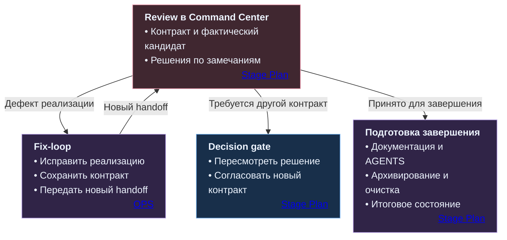
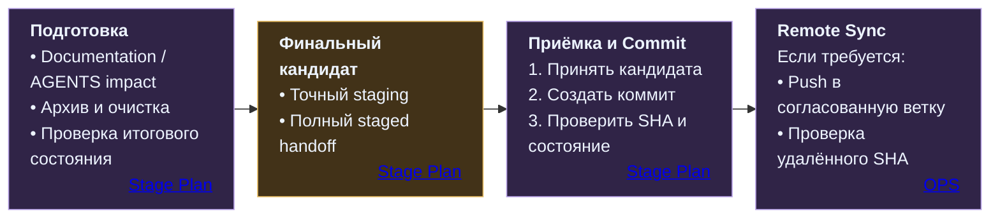

# Проверка результата и завершение Stage

[README](../../README.md) · [Устройство системы](SYSTEM.md) · [Этапы работы](STAGES.md) · [Codex в репозитории](CODEX.md) · [Полный процесс](../../PRESENTATION.md)

Review в управляющем веб-чате Command Center связывает исходное поручение, фактический результат, проверки и решение о дальнейшей работе. Проверяется и качество изменений, и их соответствие принятому контракту. Приёмка остаётся в контуре специалиста и Command Center.

**Code review в репозитории** — отдельная техническая проверка по процедуре review-code. Она возвращает заключение, подтверждённые замечания и оставшиеся риски. Эти материалы помогают принять решение в Command Center; положительное заключение само по себе не разрешает реализацию, изменение архитектуры, Commit или выпуск.

[Материалы проверки](#что-передаётся-на-проверку) · [Замечания](#как-обрабатываются-замечания) · [Fix и Decision gate](#исправление-или-новое-решение) · [Завершение](#от-принятого-результата-к-завершению-stage)

## Что передаётся на проверку

Для проверки нужен исходный принятый контракт и однозначно определённое состояние результата. У [Review есть два основных входа](../../Stage_Plan_Protocol.md#72-review-findings-disposition):

| Результат | Что проверяется | Куда ведёт Review |
|---|---|---|
| **Codex Audit** | Выводы, факты репозитория, альтернативы и риски до реализации | Обратно в Decision gate для принятия решения |
| **OPS Task или Fix с изменениями** | Фактические изменения относительно исходного задания | К исправлению, пересмотру решения или подготовке завершения |

После задачи, изменившей репозиторий, до Review собирается **Repo change handoff**:

- **Контракт:** исходный OPS Task, Stage Brief для TS-B и необходимые архитектурные основания.
- **Состояние:** точные границы задачи, исходная точка сравнения и проверяемый кандидат изменений.
- **Изменения:** `git status --short --untracked-files=all`, отдельный `.diff`, статистика и `git diff --check` либо соответствующая проверка staged-изменений.
- **Подтверждения:** выполненные проверки, причины пропусков, итог Codex, известные риски и препятствия.
- **Предыдущие замечания:** существенные findings с сохранёнными идентификаторами, если проверка продолжается после исправлений.

Command Center определяет режим передачи и готовит точные команды с фактическими путями и границами. Специалист передаёт пакет управляющему чату. Состав материалов задан в [Repo change handoff](../../Stage_Plan_Protocol.md#71-repo-change-handoff) и [входах code review](../../OPS_CENTER_CODEX_PROTOCOL.md#101-обычный-code-review).

**Baseline** обозначает исходное состояние для сравнения, **delta** — изменение относительно него, **candidate** — состояние, предлагаемое к проверке. При последовательных Fix index может хранить состояние до текущего исправления и служить технической базой сравнения. Такая фиксация сама по себе не означает приёмку или Commit; существующая пользовательская и параллельная работа сохраняется.

Каждый цикл получает новый diff-артефакт в `docs/codex/diff/`. Предыдущее evidence сохраняется; отчёт и diff одного Review используют согласованную идентичность этапа и номер цикла. Правила имён описаны в [Architecture Map](../../Architecture_Map.md#canonical-stage-bound-artifact-identity).

## По каким основаниям проводится Review

Проверяется именно представленный кандидат относительно исходного принятого Task/Brief. Проверяющий получает тот же существенный архитектурный контракт, который ограничивал исполнителя. Новая задача на review задаёт область проверки, сохраняя исходную спецификацию работы.

В [code review](../../.agents/skills/review-code/SKILL.md) рассматриваются корректность, архитектура, контракты, тесты, безопасность, сопровождаемость и интеграционные риски — в пределах поставленной задачи. Замечание связывает конкретное место и подтверждение с последствиями и рекомендацией; предположение обозначается как вопрос или риск.

Если обязательные архитектурные основания отсутствуют, недоступны или противоречат друг другу, соответствующее направление проверки отмечается **blocked / incomplete**. Другие применимые проверки могут продолжаться в разрешённой области. Принятую архитектуру не восстанавливают по форме кода или памяти проверяющего. Эти условия определены в [OPS: обычный code review](../../OPS_CENTER_CODEX_PROTOCOL.md#101-обычный-code-review).

Заключения `approve`, `approve with comments`, `request changes` характеризуют результат code review. Решение о принятии работы учитывает контракт, факты, существенность замечаний и их явные исходы. Краткое резюме, сохранённый отчёт и успешные тесты дополняют handoff фактического состояния.

## Как обрабатываются замечания

У существенного finding должен быть понятный исход. [Stage Plan](../../Stage_Plan_Protocol.md#72-review-findings-disposition) предусматривает:

| Исход | Что он означает |
|---|---|
| **Fixed now** | Исправление выполнено и подтверждено |
| **Accepted risk** | Риск явно принят |
| **Deferred to Stage/Step** | Замечание перенесено в конкретный этап или вопрос |
| **Converted to OPS Task** | Работа выделена в отдельную задачу |
| **Rejected with reason** | Замечание отклонено с объяснением |
| **Intentionally not carried** | Явно решено не переносить замечание дальше |
| **Keep as-is / protected non-change** | Рассмотренный участок сохраняется без изменений |

Между циклами существенные замечания сохраняют стабильные идентификаторы. Объединение и разделение findings отмечаются явно, чтобы повторная проверка учитывала уже принятые решения.

- **P0** требует явного решения до закрытия Review.
- **P1** нельзя переносить дальше без ближайшего Stage/Step либо согласованной отсрочки.
- **P2** может быть отложено или закрыто как cleanup, с явным решением по дальнейшей судьбе.

Если используется другая шкала серьёзности, сохраняются её обозначения и тот же принцип явных исходов. Принятие определяется существенностью, областью задачи и решениями по замечаниям. Механическое условие «замечаний должно стать ноль» не задаёт качество приёмки.

## Исправление или новое решение

Для результата с изменениями дальнейший путь зависит от того, сохраняется ли принятый контракт:

**Fix-loop** исправляет реализацию внутри прежнего принятого контракта. Если для исправления требуется изменить требования, архитектуру, владельцев, зависимости, публичное поведение, модель хранения или существенные границы и риски, нужен возврат с подтверждениями в **Decision gate** до таких изменений. Соседняя неблокирующая проблема сохраняется для решения по ней и сама по себе не расширяет текущую работу. Граница задана в [OPS: Stop conditions](../../OPS_CENTER_CODEX_PROTOCOL.md#13-stop-conditions).

Масштаб проверки определяет организацию проходов:

- **Strict incremental — основной порядок:** каждый нетривиальный Fix получает отдельный delta и Review.
- **Cumulative — для небольшой связанной серии:** Command Center может объединить исправления при неизменных контракте, архитектуре, зависимостях и существенных границах и рисках. На итоговую проверку передаётся вся серия относительно общей базы.
- **Batch review — для большого объёма материалов:** один большой diff или отчёт проверяется частями с ограниченной целью и промежуточными выводами. Сборная картина обновляется после каждой части; завершение требует обработки всех запланированных частей и решений по существенным замечаниям.

Правила режимов находятся в [Repo change handoff](../../Stage_Plan_Protocol.md#71-repo-change-handoff) и [Batch processing](../../Stage_Plan_Protocol.md#73-batch-processing-в-review). Для большого репозиторного code review ведётся [единый Batched Code Review Report](../../.agents/skills/review-code/SKILL.md#81-batched-code-review-report), а выводы разных частей проверяются на совместимость.

## От принятого результата к завершению Stage

После принятия реализации для завершения проверяется её влияние на постоянные документы и AGENTS. Обновляются только затронутые владельцы в разрешённой области. Если поручение не разрешает менять AGENTS, Codex сообщает о необходимом изменении; сама правка получает отдельное разрешение и соответствующий объём исполнения.

**Архивирование и очистка.** Для обычной очистки предлагаются отработанные одноразовые файлы из `docs/codex/*`. Нужные для продолжения, проверки, повторного использования и восстановления материалы сохраняются. Отработанное evidence с исторической ценностью может перейти в Project History, временные ненужные артефакты — в согласованную очистку. Архивирование следует порядку **inventory → copy → verify → cleanup source**: исходники удаляются только после проверки копий. Постоянные проектные сведения остаются у своих владельцев. Границы и порядок заданы в [Commit cleanup](../../Stage_Plan_Protocol.md#74-commit-cleanup).

**Финальный staged handoff.** Изменения документации, AGENTS и очистки, затрагивающие репозиторий, также проходят handoff и Review. Затем финальный пакет показывает весь предлагаемый к Commit объём относительно HEAD, а не только последнее исправление. Для первого коммита без HEAD базой явно служит пустое дерево Git.

**Точная приёмка.** В Commit попадает принятый кандидат без посторонних staged-изменений и непринятых изменений внутри области задачи. Новое изменение получает свои подтверждения и приёмку. SHA подтверждает идентичность сопоставимого состояния; качество и соответствие контракту оцениваются при Review.

**Commit и Remote Sync.** После коммита проверяются фактический SHA и состояние репозитория. Push выполняется отдельно, когда он предусмотрен контрактом завершения и определена каноническая удалённая цель. Проверяются local HEAD, SHA ожидаемой remote-ветки и итоговое состояние. Если удалённую проверку выполнить нельзя, результат отмечается `Remote verification: unresolved`; автоматический повторный push не подменяет эту проверку.

Если репозиторий не менялся, staging и Commit пропускаются. Stage закрывается после выполнения всех применимых обязательств, включая Remote Sync, когда он необходим. Итоги и точка продолжения сохраняются в [памяти проекта](LIBRARY.md). Временные ветки, worktree и refs очищаются отдельно после проверки сохранности принятого состояния; изменения отслеживаемых файлов завершаются до финального staging. Полный порядок — в [Завершении Stage](../../Stage_Plan_Protocol.md#76-завершение-stage).

## Источники

Этот файл объясняет проверку и завершение. Точные условия, полномочия и порядок операций принадлежат следующим элементам системы:

| Тема | Источник |
|---|---|
| Кандидат, baseline, diff и повторные проверки | [Stage Plan: Repo change handoff](../../Stage_Plan_Protocol.md#71-repo-change-handoff) |
| Исходы замечаний и граница Fix-loop | [Review findings disposition](../../Stage_Plan_Protocol.md#72-review-findings-disposition) |
| Большой Review | [Batch processing](../../Stage_Plan_Protocol.md#73-batch-processing-в-review) · [review-code: batch rules](../../.agents/skills/review-code/SKILL.md#83-batch-review-rules) |
| Входы code review и незавершённые проверки | [OPS: обычный code review](../../OPS_CENTER_CODEX_PROTOCOL.md#101-обычный-code-review) |
| Основания для возврата к решению | [OPS: Stop conditions](../../OPS_CENTER_CODEX_PROTOCOL.md#13-stop-conditions) |
| Архивирование и безопасные команды | [Commit cleanup](../../Stage_Plan_Protocol.md#74-commit-cleanup) · [Правила PowerShell](../../Stage_Plan_Protocol.md#75-commit-commands-и-общие-правила-powershell) |
| Финальная приёмка, Commit и Remote Sync | [Завершение Stage](../../Stage_Plan_Protocol.md#76-завершение-stage) |

[К началу](#проверка-результата-и-завершение-stage) · [README](../../README.md) · [Этапы работы](STAGES.md) · [Codex в репозитории](CODEX.md) · [Память проекта](LIBRARY.md) · [Полный процесс](../../PRESENTATION.md)
