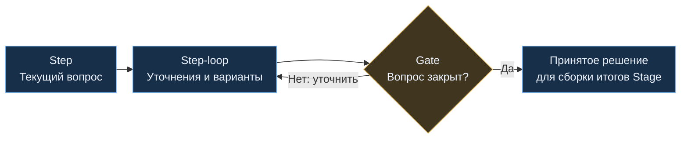
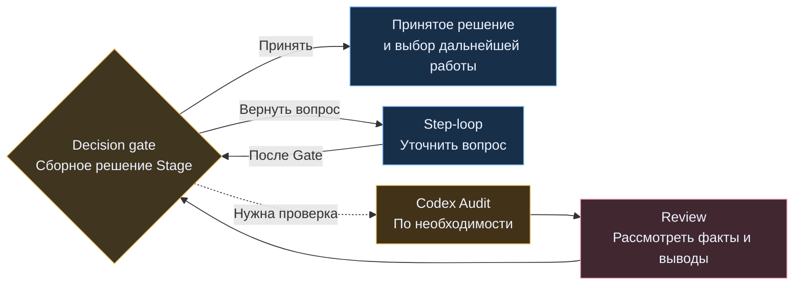
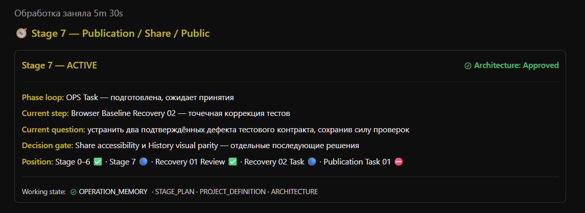

# Как проект движется по этапам

[README](../../README.md) · [Устройство системы](SYSTEM.md) · [Полный процесс](../../PRESENTATION.md) · [Веб-схема](../../PRESENTATION.md#web-process)

[Stage Plan](../../Stage_Plan_Protocol.md) организует длительную работу в управляющем веб-чате Command Center. **Stage** задаёт цель и границы этапа, **Step** удерживает один текущий вопрос, а контрольные точки связывают обсуждение с принятием решений и дальнейшей работой.

Верхнеуровневый план показывает направления, ожидаемые итоги, риски и зависимости. Конкретные вопросы уточняются при входе в этап; количество обсуждений заранее не фиксируется. Codex получает отдельное ограниченное задание, когда нужна проверка репозитория или исполнение принятого решения.

## От замысла к рамке этапа

- **Верификация намерения.** Перед Stage 0, уточнением рамки этапа, обсуждением Step и составлением верхнего плана Command Center проверяет, как понята цель, отделяет факты от предположений и обозначает границы. При риске неверного направления задаёт вопросы и ждёт ответа. Если цель ясна, явно фиксирует, что уточнения не требуются.
- **Stage 0 — собрать замысел.** Если цель и верхний план ещё не определены, уточняются назначение проекта, цель, границы и риски; появляется предварительная карта этапов. Итог — определение проекта и верхнеуровневый план, которые сохраняются в рабочей памяти веб-чата.
- **Stage 1 — каркас нового проекта.** Для проекта с нуля согласованные архитектурные решения переводятся в минимальный проверяемый каркас репозитория и адаптированный AGENTS. Физическую работу выполняет Codex через обычную OPS-задачу. В существующем проекте сохраняется нумерация этапов; необходимая подготовка включается в согласованный Stage без пересоздания корректного каркаса.
- **Stage X.0 — рамка текущего этапа.** Повторно уточняются цель, границы, вопросы и начальное состояние архитектурного решения. Например, `14.0` — рамка Stage 14, `14.1` и `14.2` — его вопросы, `14.1.1` и `14.1.2` — уточнения внутри первого вопроса.

Stage 0 формирует замысел; подготовка конкретного репозитория относится к Stage 1. Подробности — в [правилах старта](../../Stage_Plan_Protocol.md#3-stage-0-и-старт-работы) и [Repo foundation](../../Stage_Plan_Protocol.md#33-stage-1--repo-foundation).

## Один вопрос: Step, Step-loop и Gate

Внутри Step рассматриваются варианты, ограничения и основания решения. **Step-loop** позволяет возвращаться к деталям столько раз, сколько требуется для закрытия вопроса. **Gate** фиксирует сформулированное и принятое решение по этому Step. Их различия определены в [базовых сущностях Stage Plan](../../Stage_Plan_Protocol.md#2-базовые-сущности).

Если в этапе остаются вопросы, открывается следующий Step. Gate относится к одному вопросу и фиксируется внутри него. В списке фаз `Phase loop` отдельного значения Gate нет.

## Решение по всему Stage

В **Decision gate** Command Center сводит решения завершённых Step, проверяет их совместимость и формирует сборное решение этапа. Дальше можно принять его, вернуть вопрос на уточнение или проверить существенную неопределённость отдельным Codex Audit. Эти переходы описаны в [рабочем порядке Stage Plan](../../Stage_Plan_Protocol.md#4-рабочий-порядок).

**Codex Audit — необязательная проверка без изменения продукта.** Она нужна, когда факты репозитория, совместимость, альтернативы или риски могут существенно повлиять на решение. Для неё готовится отдельная OPS-задача. Результат проходит Review, после чего Decision gate открывается повторно. Выводы аудитора помогают принять решение; разрешение на реализацию оформляется отдельно.

## Навигация в рабочем чате

В начале каждого stage-сообщения Command Center показывает [навигационную плашку](../../Stage_Plan_Protocol.md#6-навигационная-плашка). Это компактный ориентир: текущий этап, фаза работы, зрелость решения, открытый вопрос, условие перехода и позиция среди Step.

[Формат плашки](../../Stage_Plan_Protocol.md#6-навигационная-плашка) · [Нумерация](../../Stage_Plan_Protocol.md#5-нумерация) · [Рабочее состояние](../../Command_Center_Working_State_Protocol.md#7-navigation-integration)

  

На снимке Task подготовлен и ожидает принятия, архитектурное решение уже принято, а задача публикации ещё заблокирована. Плашка позволяет видеть эти состояния одновременно; разрешение на следующий шаг определяется решением по задаче.

**Position** показывает положение этапа и его вопросов по [статусной шкале](../../Stage_Plan_Protocol.md#64-position-и-статусная-шкала). Строка **Working state** даёт доступ к активным файлам опорного состояния проекта; она перечисляет [логических владельцев](../../Command_Center_Working_State_Protocol.md#7-navigation-integration), независимо от имён конкретных поколений файлов. Различия фазы работы, текущего вопроса и зрелости решения раскрыты ниже.

## Фаза работы и зрелость решения

- **[Phase loop](../../Stage_Plan_Protocol.md#61-phase-loop)** — текущее действие: уточнение рамки, обсуждение Step, Decision gate, аудит, подготовка задания, Review, Fix-loop или Commit. Каждый этап проходит нужные ему фазы.
- **[Architecture](../../Stage_Plan_Protocol.md#63-architecture)** — зрелость архитектурного решения, которая сохраняется при переходах между фазами.
- **[Current step / Current question](../../Stage_Plan_Protocol.md#62-current-step--current-question--decision-gate)** — открытый Step и конкретный вопрос. Поле **Decision gate** во время обсуждения показывает условие закрытия Step, а в одноимённой фазе — условие принятия сборного решения Stage.

| Architecture | Смысл |
|---|---|
| `N/A` | Архитектурной составляющей в этом этапе нет |
| `Existing` | Работа следует уже принятой архитектуре |
| `Exploring` | Решение формируется или пересматривается |
| `Proposed` | Предварительное решение сформулировано и ожидает принятия либо проверки |
| `Assessed` | Дополнительная проверка проведена, её результат рассмотрен в Review |
| `Approved` | Command Center принял архитектурное решение в границах этапа |

Это состояния, а не обязательная последовательность. Достаточные основания позволяют перейти из `Proposed` сразу в `Approved`; `Assessed` используется после фактически проведённой проверки и ещё не означает принятия. При существенных новых фактах решение возвращается в `Exploring`.

Для изменения архитектуры реализация опирается на принятое решение. `Existing` и `N/A` не требуют нового архитектурного согласования. Codex предоставляет факты и рекомендации; состояние `Approved` устанавливает Command Center. Затем фактическую реализацию проверяют на соответствие принятой архитектуре.

## От решения к работе Codex

Когда требуется работа через OPS, обязателен **OPS Task**. Форма задания выбирается по смыслу контракта:

- **TS-A:** компактная спецификация и условия исполнения находятся в самом Task.
- **TS-B:** сначала создаётся отдельный Stage Brief с подробной принятой спецификацией, затем Task с точной ссылкой на него.

После размещения и проверки файлов специалист передаёт Codex стартовый запрос с точным путём Task. При чтении порядок другой: Codex читает AGENTS, затем Task; при необходимости выбирает и читает применимый маршрут, после чего загружает Brief для TS-B. Подробности — в [OPS: порядок создания и чтения](../../OPS_CENTER_CODEX_PROTOCOL.md#authoring-order-и-loading-order).

После изменений перед Review передаётся проверяемый **Repo change handoff**; после аудита Review опирается на выводы и подтверждающие материалы. **Fix-loop** исправляет реализацию в рамках прежнего принятого контракта. Если меняются требования, архитектура или границы полномочий, вопрос с подтверждающими материалами возвращается в Decision gate. Найденная рядом проблема сама по себе не расширяет задачу. Порядок работы с замечаниями описан в [Review, Fix-loop и Commit](../../Stage_Plan_Protocol.md#7-review-fix-loop-и-commit).

Этап может завершиться обсуждением или исследованием без передачи основной работы Codex. Исполнение большой задачи может идти частями внутри одного Task и применимого ExecPlan. Такие части не становятся новыми Stage, Step или поручениями, пока сохраняются принятый контракт, границы задачи и существенные риски.

## Когда Stage завершён

Завершение связывает принятый результат с итоговым состоянием проекта:

- Результат рассмотрен; по существенным замечаниям зафиксированы решения.
- Выполнены разрешённые обновления постоянной документации и AGENTS, если изменения их затронули, а также согласованные архивирование и очистка.
- Если репозиторий менялся, проверено итоговое состояние, подготовлен финальный staged handoff и получена финальная приёмка перед Commit. Проверяется фактический SHA коммита.
- Если репозиторий не менялся, staging и Commit пропускаются.
- Если договорённости о завершении требуют Remote Sync, отдельно выполняются push и проверка удалённого состояния.
- Выполнены остальные применимые действия завершения; сохранены итоги и точка продолжения.

Stage закрывается после выполнения этих обязательств. Порядок Git-операций и состав handoff определяются [правилами завершения Stage](../../Stage_Plan_Protocol.md#76-завершение-stage); обработка замечаний — [Review findings disposition](../../Stage_Plan_Protocol.md#72-review-findings-disposition), сохранение состояния — [Working State](../../Command_Center_Working_State_Protocol.md#8-synchronization-model).

## Источники

Этот файл объясняет этапы работы. Правила и точные условия переходов задают следующие элементы системы:

| Тема | Источник |
|---|---|
| Верификация цели и начальный план | [Stage Plan: верификация намерения](../../Stage_Plan_Protocol.md#32-верификация-намерения) · [Верхнеуровневый план](../../Stage_Plan_Protocol.md#31-принцип-верхнеуровневого-stage-plan) |
| Step, Gate и выбор дальнейшей работы | [Базовые сущности](../../Stage_Plan_Protocol.md#2-базовые-сущности) · [Рабочий порядок](../../Stage_Plan_Protocol.md#4-рабочий-порядок) |
| Плашка, нумерация и зрелость решения | [Нумерация](../../Stage_Plan_Protocol.md#5-нумерация) · [Навигационная плашка](../../Stage_Plan_Protocol.md#6-навигационная-плашка) · [Architecture](../../Stage_Plan_Protocol.md#63-architecture) |
| Задание Codex | [OPS: сборка задания](../../OPS_CENTER_CODEX_PROTOCOL.md#6-как-chatgpt-собирает-задачу-codex) |
| Review, Fix и завершение | [Исходы замечаний](../../Stage_Plan_Protocol.md#72-review-findings-disposition) · [Завершение Stage](../../Stage_Plan_Protocol.md#76-завершение-stage) |
| Память управляющего чата | [Working State](../../Command_Center_Working_State_Protocol.md) |

[README](../../README.md) · [Устройство системы](SYSTEM.md) · [Полный процесс](../../PRESENTATION.md) · [Веб-схема](../../PRESENTATION.md#web-process)
