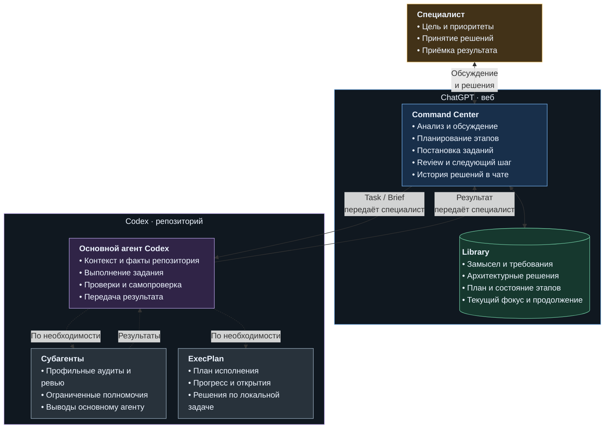

# Как устроен Command Center

[README](../../README.md) · [Полный процесс](../../PRESENTATION.md) · [Веб-схема](../../PRESENTATION.md#web-process) · [Локальная схема](../../PRESENTATION.md#repo-process)

Command Center — система оркестрации разработки с ИИ-агентами под управлением специалиста. Она связывает обсуждение проекта, принятие решений, постановку ограниченных заданий, локальное исполнение и проверку результата. Специалист ведёт работу через чат, сохраняя контроль над целью, архитектурой и приёмкой изменений.

Её протокольная архитектура объединяет **Agent Orchestration**, **Context Engineering** и **Workflow Design**: распределение работы между участниками, организацию контекста и проектирование этапов с условиями переходов. Нужные сведения хранятся у определённых владельцев, а между средами передаются конкретные задания и проверяемые результаты. Текстовые протоколы определяют, какой контекст нужен участнику и какие решения он вправе принимать. Файлы сохраняют основания работы и точку продолжения после паузы или смены чата.

## Две среды и специалист между ними

Это обзор участников и каналов обмена. Последовательность этапов и обратные переходы показаны в [PRESENTATION](../../PRESENTATION.md).

| Участник / слой | Ответственность |
|---|---|
| **Специалист** | Задаёт цель и приоритеты, утверждает существенные продуктовые и архитектурные решения, передаёт задания и результаты между средами, принимает или отклоняет итог |
| **ChatGPT Command Center** | Вместе со специалистом прорабатывает варианты и границы задачи, планирует этапы, готовит поручения Codex и проводит Review. История чата сохраняет ход обсуждения и основания решений; значимое состояние переносится в Library |
| **ChatGPT Library** | Хранит выделенное опорное состояние проекта: замысел и требования, архитектурные решения, план этапов и оперативную память. Эти файлы поддерживают направление работы и продолжение между чатами |
| **Основной агент Codex** | Исследует реальный репозиторий, выбирает локальную тактику внутри принятого задания, выполняет разрешённую работу и возвращает результат с подтверждениями |
| **Субагенты Codex** | Получают ограниченные поручения от основного агента и возвращают результаты в пределах своих полномочий; основной агент сопоставляет и объединяет их выводы |

## Где находятся решения и факты

**Чат и Library дополняют друг друга.** История чата сохраняет ход обсуждения: варианты, аргументы, уточнения и принятые решения. Library хранит выделенное опорное состояние, которое удерживает замысел, архитектуру и текущую позицию проекта при длительной работе и смене чатов. В ней разделены четыре владельца:

- `PROJECT_DEFINITION.md` — назначение и требования.
- `ARCHITECTURE.md` — текущие архитектурные основания.
- `STAGE_PLAN.md` — маршрут этапов.
- `OPERATION_MEMORY.md` — текущий вопрос и точка продолжения.

Согласованное архитектурное решение может быть записано до реализации: утверждённая цель и существующий код различаются по смыслу.

**Репозиторий показывает фактическую реализацию.** Код, постоянная проектная документация, Git-состояние и результаты проверок дают основания для анализа изменений. Проектный `AGENTS.md` задаёт локальные правила и границы полномочий; маршруты и skills определяют применимые процедуры. Codex самостоятельно выбирает тактику исполнения внутри разрешённых границ, а изменение самого принятого контракта возвращается на решение специалиста и Command Center.

**ExecPlan сопровождает отдельную локальную задачу.** Он хранит план исполнения, прогресс, открытия и решения для длительной работы Codex. Опорное состояние управляющего веб-чата хранится в Library, а история обсуждения — в самом чате. Отчёты и diff служат материалами проверки. Принятые выводы и решения фиксируются в постоянных проектных документах.

## Как передаётся работа

1. **Из веба в репозиторий.** Command Center готовит OPS Task и, когда нужен отдельный подробный контракт, Stage Brief. Специалист переносит файлы по подготовленным командам и передаёт Codex стартовый запрос с точным путём задания.
2. **Из репозитория в веб.** После изменений Codex возвращает проверяемый кандидат: состав изменений, diff, выполненные проверки и известные риски. После аудита возвращаются выводы и подтверждающие материалы. Специалист передаёт этот пакет управляющему чату.
3. **Следующее решение.** Command Center сопоставляет результат с заданием. Специалист принимает работу, возвращает конкретные замечания на исправление либо пересматривает контракт. Принятые итоги и точка продолжения сохраняются у соответствующих владельцев.

## Основные источники

Этот файл объясняет устройство системы. Действующие правила процесса и полномочий задают протоколы и локальные правила; карты помогают находить нужные сведения и анализировать архитектуру.

| Источник | Что определяет |
|---|---|
| [Role](../../Command_Center_Role.md) | Инженерную роль и границы управляющего чата |
| [Stage Plan](../../Stage_Plan_Protocol.md) | Этапы, вопросы, контрольные точки, Review и завершение |
| [OPS](../../OPS_CENTER_CODEX_PROTOCOL.md) | Постановку задания Codex, передачу и анализ результата |
| [Working State](../../Command_Center_Working_State_Protocol.md) | Владельцев памяти веб-чата, обновление и восстановление |
| [Architecture Map](../../Architecture_Map.md) | Слои, владельцев и размещение артефактов |
| [Reasoning Guide](../../Architecture_Reasoning_Guide.md) | Области архитектурного анализа и связанные вопросы |
| [AGENTS](../../AGENTS.md) | Шаблон локального входа, ограничения и навигацию Codex |
| [ExecPlan](../../.agents/PLANS.md) | Правила ведения плана длительной локальной задачи |
| [Skills](../../.agents/skills/) · [Субагенты](../../.codex/agents/) | Процедуры операций и полномочия дополнительных исполнителей |

[README](../../README.md) · [Полный процесс](../../PRESENTATION.md) · [Веб-схема](../../PRESENTATION.md#web-process) · [Локальная схема](../../PRESENTATION.md#repo-process)
