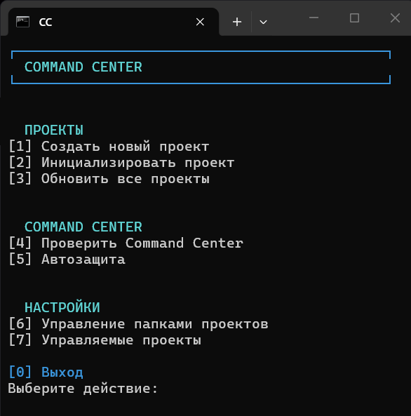
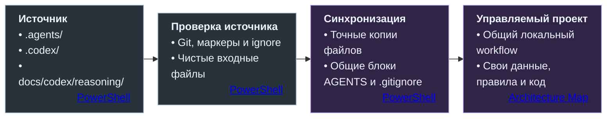
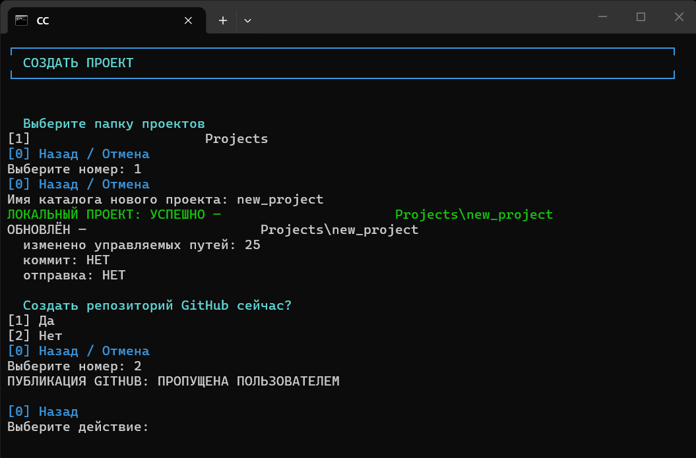
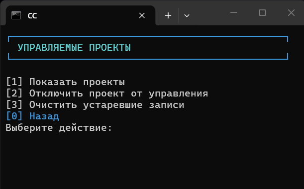
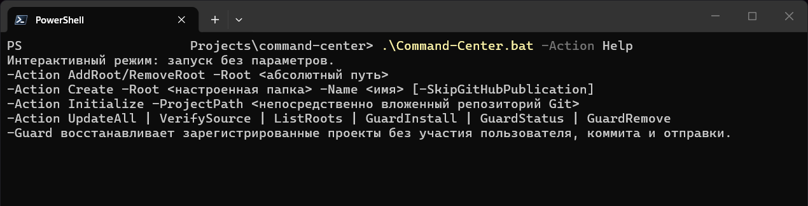

# Локальная инфраструктура Command Center

[README](../../README.md) · [Устройство системы](SYSTEM.md) · [Codex в репозитории](CODEX.md) · [Проверка и завершение](REVIEW.md) · [Полный процесс](../../PRESENTATION.md)

PowerShell-инструмент распространяет и проверяет **локальную инфраструктуру Command Center в зарегистрированных Git-репозиториях**. Он подготавливает агентскую среду для нового проекта, подключает существующий, обновляет общие файлы и поддерживает их актуальное состояние.

[Command-Center.bat](../../Command-Center.bat) открывает интерфейс и передаёт параметры движку [scripts/command-center.ps1](../../scripts/command-center.ps1). Постановкой задач, архитектурными решениями и приёмкой продолжает управлять процесс Command Center; скрипт обслуживает его локальную инфраструктуру.

<p align="center">
  
</p>

[Распространение](#что-распространяется-в-проекты) · [Операции](#создание-подключение-и-обновление) · [Реестр](#папки-и-управляемые-проекты) · [Guard](#опциональный-guard) · [Запуск](#запуск-и-диагностика)

## Что распространяется в проекты

Источником служит физический Git-репозиторий Command Center, из которого запущен скрипт. Перед синхронизацией проверяются его готовность и чистота распространяемой части.



| Область | Как обрабатывается |
|---|---|
| **`.agents/`, `.codex/`, `docs/codex/reasoning/`** | Копируются текущие отслеживаемые Git файлы по точным путям. Наличие и SHA-256 определяют необходимость замены |
| **AGENTS.md** | Обновляется общий блок workflow между маркерами; проектная часть вне него сохраняется. Для отсутствующего файла используется шаблон |
| **.gitignore** | Универсальные правила из шаблона источника собираются в управляемый блок проекта; остальные проектные правила сохраняются |
| **Рабочие артефакты** | В `tasks`, `stage_briefs`, `reports`, `plans`, `diff` создаются недостающие `.gitkeep`. Содержимое рабочих артефактов не копируется; для каталогов применяются ignore-правила |
| **Продуктовый код и данные** | Остаются ответственностью конкретного проекта |

Синхронизация обновляет перечисленные управляемые пути. Неизвестные файлы целевого проекта не удаляются; веб-протоколы, презентационная документация и Library этим механизмом не распространяются. Границы описаны в [Architecture Map](../../Architecture_Map.md#13-local-distribution-subsystem).

При несовместимом или неоднозначном AGENTS обычное обновление останавливается. Интерактивное подключение существующего проекта допускает полную замену файла только после явных подтверждений. Обычное обновление использует [границы управляемого блока](../../scripts/command-center.ps1#L532-L705).

## Создание, подключение и обновление

| Действие | Результат |
|---|---|
| **Create** | Новый каталог внутри настроенной папки проектов, Git-ветка `main`, локальная инфраструктура Command Center и регистрация проекта |
| **Initialize** | Подключение существующего Git-репозитория и синхронизация инфраструктуры с сохранением проектных областей |
| **UpdateAll** | Обновление зарегистрированных проектов из настроенных папок и отдельные результаты по каждому проекту |

**Создание проекта.** Create подготавливает агентскую среду. Первый коммит содержит только `.gitignore`; каркас и функции самого продукта затем создаются через согласованные задания Codex. После успешного локального создания можно отдельно выбрать GitHub-публикацию. Скрипт определяет авторизованный аккаунт через `gh`, предлагает выбрать видимость и запрашивает подтверждение создания и отправки. `-SkipGitHubPublication` пропускает этот шаг. Реализация — [Create-NewProject](../../scripts/command-center.ps1#L1176-L1254) и [Publish-NewProjectToGitHub](../../scripts/command-center.ps1#L1136-L1173).

<details>
<summary>Экран создания проекта</summary>

<p align="center">
  
</p>

На снимке локальный проект создан, а публикация на GitHub пропущена по выбору пользователя.

</details>

**Ручная синхронизация и Git.** Initialize и обычный UpdateAll могут сформировать служебный коммит и отправить его. Его область ограничена `.gitignore` и прекращением Git-учёта путей, которые скрипт распознаёт как приватную инфраструктуру; сами файлы сохраняются на диске. Копируемое ядро остаётся локальной игнорируемой инфраструктурой. Произвольные продуктовые изменения в этот коммит не включаются. Уже отслеживаемые неизвестные приватные файлы отмечаются для ручного решения.

Для такого коммита используется [изолированный временный индекс](../../scripts/command-center.ps1#L862-L917). Если `.gitignore` уже изменён до обновления или инфраструктурный путь имеет staged-изменения, скрипт сообщает о необходимости ручного решения. Ранее существовавший staging не становится содержимым служебного коммита.

Push возможен после проверки исходного совпадения local HEAD с настроенной удалённой веткой. Непосредственно перед отправкой повторно проверяются local HEAD и remote SHA; после отправки — удалённый результат. Условия реализованы в [Get-PushPreflight](../../scripts/command-center.ps1#L818-L854) и [Push-UpdaterCommit](../../scripts/command-center.ps1#L919-L943).

## Папки и управляемые проекты

Локальный реестр `config/distribution.local.json` в источнике хранит:

- настроенные папки проектов;
- список зарегистрированных репозиториев;
- идентичность задания Guard в планировщике.

**Папка проектов** — контейнер вне Git-дерева. Скрипт рассматривает непосредственно вложенные Git-репозитории; **регистрация** отдельно определяет, какие из них обновляются. Само обнаружение папки с репозиторием не подключает её автоматически. Источник Command Center исключён из целей синхронизации по разрешённому физическому пути.

Параметрические действия **AddRoot**, **RemoveRoot**, **ListRoots** управляют списком папок. В интерфейсе «Управляемые проекты» можно посмотреть регистрации, отключить проект от управления и убрать устаревшие записи. Эти действия с регистрациями сохраняют файлы репозиториев. В интерфейсе управления папками удаление опустевшего каталога с диска предлагается отдельно, с подтверждением.

<details>
<summary>Экран управления зарегистрированными проектами</summary>

<p align="center">
  
</p>

</details>

Реестр и `config/guard.local.log` исключены из Git. Отсутствующий реестр читается как пустое состояние; личные пути и регистрации настраиваются на конкретной машине. Устройство реестра — в [Read-Registry](../../scripts/command-center.ps1#L284-L328).

## Опциональный Guard

Guard восстанавливает локальную управляемую инфраструктуру зарегистрированных проектов. Его можно вызвать вручную через `-Guard` или установить периодический запуск Windows Scheduled Task — каждые 30 минут.

| Режим | Что делает |
|---|---|
| **`-Guard`** | Проверяет и восстанавливает управляемые файлы; сохраняет итог в локальном журнале |
| **GuardInstall** | Устанавливает принадлежащее этому реестру задание планировщика |
| **GuardStatus** | Показывает состояние задания и проверяет его принадлежность |
| **GuardRemove** | Удаляет задание планировщика, принадлежащее этому реестру |

**Guard не создаёт Commit, не выполняет push и не исключает файлы из Git-индекса.** Это восстановление локальной инфраструктуры, а не read-only проверка: содержимое управляемых путей может быть обновлено из источника. Ошибка одного проекта отражается в результате и не отменяет обработку остальных. Планировщик и его границы реализованы в [Invoke-GuardScheduler](../../scripts/command-center.ps1#L1362-L1420).

## Запуск и диагностика

Инструмент предназначен для Windows. BAT-файл сначала ищет `pwsh.exe`, затем `powershell.exe`. Для работы с репозиториями нужен Git, для создания коммитов — настроенная Git identity. GitHub CLI `gh` с авторизацией нужен для встроенного создания удалённого репозитория. Планировщик Guard использует Windows Scheduled Tasks.

Из корня источника запуск без параметров открывает меню:

```powershell
.\Command-Center.bat
```

Информационные действия:

```powershell
.\Command-Center.bat -Action Help
.\Command-Center.bat -Action VerifySource
.\Command-Center.bat -Action ListRoots
.\Command-Center.bat -Action GuardStatus
```

Эти действия читают справку и состояние приложения, не подключая проекты и не устанавливая Guard. **VerifySource** проверяет Git источника, обязательные файлы, маркеры, ignore-правила и чистоту распространяемой части. Это проверка готовности инфраструктуры; качество продукта оценивается в его собственном цикле исполнения и [Review](REVIEW.md).

<details>
<summary>Справка командной строки</summary>

<p align="center">
  
</p>

</details>

## Источники

Этот файл объясняет инструмент. Фактическое поведение задают скрипт и BAT-файл; состав и границы подсистемы описывает карта архитектуры.

| Тема | Источник |
|---|---|
| Запуск PowerShell-движка | [Command-Center.bat](../../Command-Center.bat) |
| Состав и границы инфраструктуры | [Architecture Map: Local distribution](../../Architecture_Map.md#13-local-distribution-subsystem) |
| Готовность источника | [Get-SourceAssessment](../../scripts/command-center.ps1#L365-L455) |
| Синхронизация проекта | [Sync-Project](../../scripts/command-center.ps1#L945-L1018) |
| Создание и подключение | [Create-NewProject](../../scripts/command-center.ps1#L1176-L1254) · [Initialize-Project](../../scripts/command-center.ps1#L1257-L1289) |
| Обновление зарегистрированных проектов | [Update-AllProjects](../../scripts/command-center.ps1#L1292-L1320) |
| Защита по расписанию | [Invoke-GuardScheduler](../../scripts/command-center.ps1#L1362-L1420) |

[К началу](#локальная-инфраструктура-command-center) · [README](../../README.md) · [Codex в репозитории](CODEX.md) · [Проверка и завершение](REVIEW.md) · [Полный процесс](../../PRESENTATION.md)
